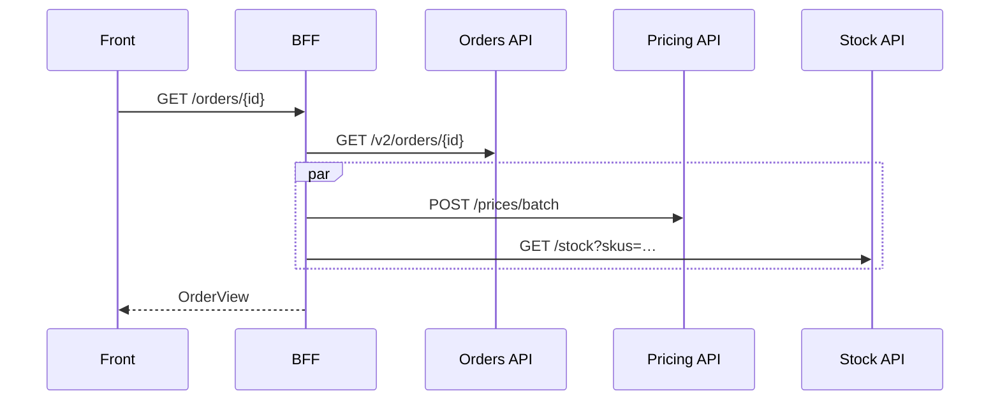

# devcards — lean, living developer docs

Capability 29 of [ai-platform-bff.md](ai-platform-bff.md). Personal-first: a local Claude Code plugin that writes short, anchored, tested cards into a vault outside the repo.

> SDD spec in [specs/devcards/](specs/devcards/requirements.md): [requirements](specs/devcards/requirements.md), [design](specs/devcards/design.md), [tasks](specs/devcards/tasks.md) and [risks](specs/devcards/risks.md). Where this document and the spec differ, the spec wins.

## Problem
LLM docs fail for three reasons:
- **No budget**: the model fills whatever space it is given.
- **Facts and explanation mixed**: it invents endpoints, fields and policies.
- **No feedback**: nobody measures whether a doc answers anything.

The result is prose, not something you can program against.

## Principles
1. **Cards, not documents.** A few card types, each with a fixed schema and a hard budget. If it doesn't fit on one screen, it's two cards.
2. **Facts from code, judgment from the model.** Deterministic extraction (Roslyn, OpenAPI, git) produces the skeleton. The model only fills small "why / watch out / edge case" slots.
3. **No anchor, no claim.** Every statement points to a symbol, a `file:line`, a PR or an explicit human note.
4. **Writer + ruthless editor.** A second agent cuts whatever a developer wouldn't miss.
5. **Docs are tested.** A reader agent must answer real questions using only the card.
6. **Docs stay alive.** Anchored code is hashed; when it changes, the card is flagged stale and regenerated from the diff.
7. **It learns from your edits.** Your corrections become style examples, and machine-owned sections never overwrite your notes.

## Card types (v1)
| Card | Content | Budget |
|---|---|---|
| **Flow** | Entry point, sequence diagram, steps, failure modes, gotchas | ≤ 8 steps · ≤ 12 arrows · ≤ 5 gotchas · ≤ 250 words of prose |
| **Field lineage** | Table: response field ← DTO ← downstream field, with transform and anchor | Table only · ≤ 3 notes |
| **Contract** | Auth, params (type/required/validation), status codes (when, body), nullability, delta vs downstream | ≤ 150 words of prose |
| **PR** | Behaviour change, contracts affected (computed), config/flags, risk, stale cards | ≤ 120 words |
| **Digest** | One line per merged PR grouped by area + "Needs your attention" (touches your files or your cards) | ≤ 1 screen |
| **Q** | One question, answer as anchored bullets, related cards | ≤ 5 bullets · ≤ 150 words |
| **Module map** | Module, one-line purpose, entry points, cards | One line per module |

Common front matter: `id`, `type`, `title`, `repo`, `source_commit`, `status` (`fresh` / `stale` / `edited`), `anchors` (`symbol`, `path`, `lines`, `hash`), `verify_score`.

### What good looks like (examples)
~~~markdown
# GET /orders/{id}

| # | Step | Where |
|---|---|---|
| 1 | Validates `id` is a GUID; 400 otherwise | `OrdersEndpoints.GetOrder` |
| 2 | Fetches the order; 404 passes through | `OrdersClient.GetAsync` |
| 3 | Price and stock in parallel (`Task.WhenAll`) | `OrderService.EnrichAsync` |
| 4 | Maps to `OrderView`; missing stock → `available = null` | `OrderMapper.ToView` |

| Downstream | Policy | BFF returns |
|---|---|---|
| Orders | 2 retries, 3 s timeout | 502 |
| Pricing | 1.5 s timeout, no retry | 200 with `price = null` |
| Stock | Circuit breaker (5 failures / 30 s) | 200 with `available = null` |

**Gotchas**
- `price = null` is a valid response; the front shows "—". Don't turn it into 0.
- Stock is cached 60 s per SKU (`StockCache`); tests may see stale data.

Lineage: [[lineage-get-orders-id]]
~~~

~~~markdown
# PR 1234 — Loyalty discount in order pricing
merged 2026-10-09 · risk: medium
- **Behaviour**: `OrderView.price` includes the loyalty discount when `X-Loyalty-Tier` is present.
- **Contracts**: `OrderView` + `discount: decimal?` (additive); Pricing API now receives `tier`.
- **Config**: `Features:LoyaltyDiscount` (default `false`).
- **Risk**: discount applied after rounding; check totals with 3+ lines.
- **Stale cards**: [[flow-get-orders-id]], [[lineage-get-orders-id]]
~~~

## Generation pipeline
```
extract (deterministic) → draft (writer) → lint (deterministic) → edit (editor) → lint → render (template) → verify (optional)
```
1. **Extract**: the `devcards extract` .NET tool, using Roslyn, writes `facts.json`:
   - endpoints (controllers and minimal APIs), DTO shapes;
   - typed and Refit `HttpClient` calls;
   - mappers (manual, AutoMapper, Mapster), DI registrations;
   - options and config keys, Polly policies.

   For PR cards it diffs `facts@base` vs `facts@head`, so "contracts affected" is **computed, not guessed**. Anything it cannot resolve (reflection, dynamic routes) is marked `inferred` or `?`, never invented.
2. **Draft**: the `writer` subagent receives the facts plus targeted code reads and returns **JSON against the card's schema**, never free markdown.
3. **Lint**: `devcards lint` checks:
   - schema and budgets (words, bullets, rows);
   - every anchor resolves (the symbol exists, the lines are valid, the hash matches);
   - banned phrases ("It is important to note", "This section", "In summary", "robust", "seamless", "leverage");
   - no code block over 6 lines;
   - no step or answer bullet without an anchor.
4. **Edit**: the `editor` subagent (read-only) applies a cut rubric:
   - text that restates identifiers or what the code obviously does;
   - generic best practices;
   - hedging, intros and outros;
   - content duplicated from another card (link instead).

   It returns a JSON patch, followed by another lint pass.
5. **Render**: a deterministic template produces markdown with wikilinks and Mermaid for Obsidian. The model never writes the final markdown.
6. **Verify** (`--verify`): questions come from fact templates ("what happens if Pricing fails?", "where does `price` come from?") plus a few from the model. A `reader` subagent answers **using only the card**, and a judge compares the answers with the facts.
   - Unanswered → the card is missing information.
   - Content never used → a candidate to cut.
   - The score is saved in `verify_score`.

## Living docs
- **Staleness**: a `SessionStart` hook runs `devcards check` on the current repo. It compares anchor hashes with `HEAD`, marks cards `stale` and prints "3 stale cards". It doesn't touch the company repo.
- **Refresh**: `/devcards:refresh` regenerates only the stale sections, using the diff of the anchored code.
- **Ownership regions**: machine-owned sections are regenerated. `## Notes` and any section you edit become human-owned and are never overwritten.
- **Learning from edits**: when a card is `edited`, the diff between the generated and the edited version is saved to `_style/examples/<type>/`. The writer receives the most relevant examples for that card type. Metric: edit distance should trend down.

## Commands (skills)
| Command | Result |
|---|---|
| `/devcards:flow <route\|symbol>` | Flow + lineage cards |
| `/devcards:contract <route>` | Contract card |
| `/devcards:pr <id\|range>` | PR card for an Azure DevOps PR or a commit range |
| `/devcards:digest [since]` | Digest of the Azure DevOps PRs merged since your last pull |
| `/devcards:capture [question]` | Turns the investigation in the current session into a Q card (or a Flow card) |
| `/devcards:ask <question>` | Answers from your cards first, with anchors; if it had to read code, offers to capture |
| `/devcards:refresh` | Regenerates stale cards |
| `/devcards:map` | Module map |

**Azure DevOps source for PR and digest cards:**
- **Git only (default, no credentials):** Azure Repos merge commits carry `Merged PR <id>: <title>`, so the PR id, title, author, date and diff come from `git log` after a pull.
- **Azure DevOps REST (optional):** with a personal PAT scoped to *Code (read)* and *Work Items (read)*, the card adds the PR description, reviewers and linked Azure Boards work items. `devcards ado login` reads the PAT in the terminal and stores it in Windows Credential Manager, so it never passes through the model.

**Consumption by the agent:** the `SessionStart` hook also injects the repo's compact index, under 1.5k tokens. Claude Code then looks at your cards before exploring the repo. Documenting for yourself also improves the agent on that project.

## Plugin layout
```
devcards/
├── .claude-plugin/plugin.json      # userConfig: vaultPath (directory), language, budgets
├── skills/{flow,contract,pr,digest,capture,ask,refresh,map}/SKILL.md
├── agents/{writer,editor,reader}.md   # editor and reader have no write tools
├── hooks/hooks.json                # SessionStart → devcards check + index
├── bin/devcards(.cmd)              # shims → tool/Devcards.Cli.dll
├── tool/                           # .NET 9 CLI: vault | guard | context | extract | lint | render | check | verify | ado
├── schemas/*.schema.json           # one per card type, with budgets
├── templates/*.md                  # deterministic rendering
└── evals/                          # claude plugin eval: sample BFF + question sets
```

## Vault layout
```
~/work-notes/<repo>/
├── index.md            # module map
├── flows/  lineage/  contracts/  prs/  digests/  questions/
├── _facts/             # facts@<commit>.json cache
├── _style/examples/    # your edits, per card type
└── _meta/cards.json    # registry: anchors, hashes, status
```

## Quality metrics
| Metric | Target |
|---|---|
| Lint pass rate on the first draft | trending up |
| Anchors that resolve | 100 % |
| Answerability (`verify_score`) | ≥ 0.9 |
| Words per answered question | trending down |
| Edit distance on your edits | trending down |
| Stale cards older than 7 days | 0 |

## Roadmap
| Phase | Scope | Value |
|---|---|---|
| **v0** (days) | Plugin skeleton, schemas, templates, `lint` (budgets, banned phrases, `file:line` + hash anchors), `/capture`, `/pr`, `/digest` | Immediate: Q cards and "what changed while I was away" |
| **v1** | Roslyn `extract`, `/flow`, `/contract`, lineage, computed contract deltas in PR cards | Real BFF knowledge: flows and field origins |
| **v2** | `SessionStart` staleness + `/refresh`, editor subagent, `--verify`, learning from edits, `/ask` | Docs that stay correct and get better |
| **v3** | The same engine in the platform pipeline; cards as the platform's context catalog; share selected cards in PR descriptions | From personal tool to team asset |

## Risks
- **Company code and a personal subscription**: confirm the data policy. Cards contain short snippets.
- **Vault location**: **never** sync the vault to a personal cloud drive or push it to any git remote outside the company's control; keep it local or in storage the company approves.
- **Extraction gaps**: reflection, dynamic routes, generated clients and AutoMapper conventions. Partial lineage is shown as `?`, never guessed.
- **Quota**: extraction is deterministic, so LLM usage is small. The editor and verify passes add cost, which is why verify is optional.
- **Over-engineering**: v0 needs no Roslyn. Ship it first and let real usage drive v1.

## Prior art
- Code-coupled docs with sync checks (Swimm).
- Diátaxis (doc types by purpose).
- Auto-generated repo wikis (DeepWiki-style), the bloated baseline this design avoids.
