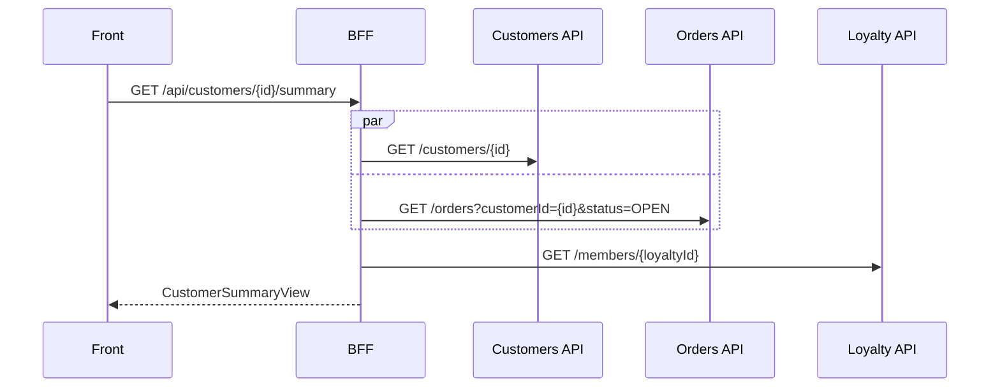

# endpoint-forge — BFF endpoint generator

Capability 12 of [ai-platform-bff.md](ai-platform-bff.md). Personal-first: a local Claude Code plugin. From a description, one or more downstream OpenAPI operations, or both, it generates the endpoint, DTOs, mappers, validation and tests, following the team's architecture. The result is a local branch the developer reviews and pushes like any other change.

> SDD spec in [specs/endpoint-forge/](specs/endpoint-forge/requirements.md): [requirements](specs/endpoint-forge/requirements.md), [design](specs/endpoint-forge/design.md), [tasks](specs/endpoint-forge/tasks.md) and [risks](specs/endpoint-forge/risks.md). Where this document and the spec differ, the spec wins.

## Problem
Adding an endpoint to a BFF is the most repetitive task the team has. It needs a route, request and response DTOs, one or more downstream clients, mappers, validation, error mapping, resilience, tests and OpenAPI metadata. The usual shortcuts fail:
- **Copy a similar endpoint**: it drifts. A missing `CancellationToken` or `ProducesResponseType`, wrong nullability, and tests for the happy path only.
- **Ask an LLM to "write an endpoint"**: it compiles, but it ignores the architecture, invents downstream fields and never tests 404s, 5xx errors, timeouts or partial responses.
- **Server stubs from an OpenAPI generator**: a 1:1 proxy of the downstream, which is exactly what a BFF should not be.

## Principles
1. **Contract first, code second.** The first output is an **endpoint plan**: the BFF contract, a lineage table (response field ← downstream field), the downstream calls, the error mapping, the validation rules and the test scenarios. The developer approves it before any code is written.
2. **No downstream spec, no downstream field.** Every response field points to a field of a provided downstream operation, a request parameter, an expression, a constant or an explicit `todo`. Nothing is invented.
3. **Deterministic where possible.** Downstream DTOs come from the repository's own client generator (Refitter, NSwag or Kiota). BFF DTOs, validators, direct mappings, registration lines and WireMock stubs are rendered from the approved plan. The model only writes the composition logic, the expressions and the test bodies.
4. **Your architecture, explicit.** A versioned profile and a few exemplar endpoints define the target. Architecture tests check it.
5. **Verified, not trusted.** The result must build, pass the formatter and the generated tests, and change the BFF's OpenAPI only by the new operation. A bounded repair loop fixes what fails.
6. **Additive and contained.** The tool creates the files in its manifest and edits only the registration points from the profile. It works on a local branch, never pushes and never adds a NuGet package.
7. **Tests cover the failure surface.** For each downstream call there are tests for success, 404, other 4xx, 5xx, timeout and missing optional fields, according to the profile's error mapping.

## Inputs and modes
| Mode | Input | Result |
|---|---|---|
| **Compose** (main) | Description + downstream operations | The plan picks the calls and maps every field from them |
| **Expose** | Downstream operations only | A mechanical plan: reshape and aggregate those operations |
| **Contract-first** | Description only | The BFF contract is designed first; downstreams become port interfaces and their fields stay `todo`. No downstream field is invented |

Downstream operations are given as `contracts/downstream/customers.json#getCustomer` (or `#GET /customers/{id}`). This is the same folder contract-guard watches in its inbound direction, so a downstream bump later tells you which generated endpoints use what changed.

## Architecture profile
`.endpoint-forge/profile.yaml`, versioned in the BFF repository and reviewed like code (abridged; the full schema is in the [design](specs/endpoint-forge/design.md#architecture-profile-endpoint-forgeprofileyaml)):
```yaml
style: minimal-api                      # minimal-api | controllers
naming: { name: "{Verb}{Resource}", request: "{Name}Request", response: "{Resource}View" }
layout:
  endpoint:  src/Bff.Api/Features/{Feature}/{Name}Endpoint.cs
  handler:   src/Bff.Application/{Feature}/{Name}Handler.cs
  mapper:    src/Bff.Application/{Feature}/{Name}Mapper.cs
  validator: src/Bff.Api/Features/{Feature}/{Name}Validator.cs
  apiTests:  tests/Bff.IntegrationTests/{Feature}/{Name}EndpointTests.cs
registration:
  - { file: "src/Bff.Api/Features/{Feature}/{Feature}Module.cs", anchor: "// endpoint-forge:endpoints" }
libraries: { validation: fluentvalidation, mapping: manual, mediator: none, tests: { framework: xunit, http: wiremock-net } }
clients: { tool: refitter, generatedPath: "src/Bff.Infrastructure/Clients/{Downstream}/Generated" }
errorMapping: { notFound: 404, clientError: 502, serverError: 502, timeout: 504 }
exemplars: [ "GET /api/orders/{id}", "POST /api/orders" ]
```
In v0 the profile is written by hand. In v2, `/endpoint-forge:init` proposes it from the code (Roslyn facts shared with [devcards](devcards.md)), and the team reviews it.

## Pipeline
```
resolve → plan (planner) → plan check → APPROVAL → scaffold → fill (implementer) → verify → repair ≤ N → report
```
1. **Resolve** (deterministic): load the profile, the selected downstream operations and only the schemas they reference, the existing routes and the exemplar files.
2. **Plan**: the `planner` subagent returns `plan.json` against a schema: route, request and validation, response fields with their sources, calls and their dependencies, error mapping and scenarios.
3. **Plan check** (deterministic): every source resolves in the provided specs, types and nullability are compatible (v1), the route is new, the calls form a DAG, missing error mappings are filled from the profile, every call and validation rule has scenarios, and names follow the profile. One retry with the violations.
4. **Approval**: the plan is rendered as markdown (see below). The developer approves it, edits `plan.json` or asks for changes. The approval is tied to the plan's hash.
5. **Scaffold** (deterministic, v1): DTOs, validators, direct mappings, registration lines, WireMock stubs and test skeletons, rendered from the plan. Missing client operations are generated with the repository's own generator.
6. **Fill**: the `implementer` subagent writes the handler, the expressions and the test bodies, following the exemplars. It has no Bash and no web tools, and a hook blocks any write outside the run manifest.
7. **Verify** (deterministic): manifest, package and banned-API checks, build, format, generated tests, one test per scenario with real assertions, the additive OpenAPI diff (oasdiff, shared with [contract-guard](contract-guard.md)), and in v2 architecture tests and lineage against the real mapper.
8. **Repair**: failures go back to the implementer, up to `maxRepairAttempts`, re-running every check each time. Deleting or skipping a test fails the scenario check.
9. **Report**: branch, manifest, check results and open `todo` fields. The rendered plan can be pasted into the PR description.

### What good looks like
~~~markdown
# Plan — GET /api/customers/{id}/summary → CustomerSummaryView
Mode: compose · feature: Customers · auth: bff
⚠ todo: `marketingConsent` (not in any provided spec)

| Field | Type | Source |
|---|---|---|
| `id` | `Guid` | request `id` |
| `displayName` | `string` | expr: Customers `firstName` + " " + `lastName` |
| `openOrders` | `int` | Orders `listOrders` → `totalCount` |
| `tier` | `string?` | Loyalty `getMember` → `tier` |
| `marketingConsent` | `bool?` | **todo** |



| Call | 404 | Other 4xx | 5xx | Timeout |
|---|---|---|---|---|
| Customers | 404 | 502 | 502 | 504 |
| Orders | 502 | 502 | 502 | 504 |
| Loyalty | 200, `tier = null` | 200, `tier = null` | 200, `tier = null` | 200, `tier = null` |

**Validation**: `id` not empty → 400.
**Scenarios (15)**: ok · id-empty · no-loyalty-id · customer-{not-found, 4xx, 5xx, timeout} · orders-{not-found, 4xx, 5xx, timeout} · loyalty-{not-found, 4xx, 5xx, timeout}
~~~

## Commands (skills)
| Command | Result |
|---|---|
| `/endpoint-forge:plan <description> [--spec <file>#<operation>]…` | The plan only, for review or to discuss with the team; writes nothing to the repository |
| `/endpoint-forge:new <description \| plan.json> [--spec …]…` | Plan → approval → branch with the generated endpoint, verified |
| `/endpoint-forge:repair` | Re-runs verification and repair on the current run branch, for example after manual edits |
| `/endpoint-forge:init` | [v2] Proposes the profile and exemplars from the code |
| `/endpoint-forge:check-profile` | [v2] Endpoints and exemplars that drifted from the profile; how much generated code survived review |

## Plugin layout
```
endpoint-forge/
├── .claude-plugin/plugin.json        # userConfig: runsPath, profilePath, language, maxRepairAttempts, commit
├── skills/{plan,new,repair,init,check-profile}/SKILL.md
├── agents/{planner,implementer}.md   # no Bash, no web tools
├── hooks/hooks.json                  # PreToolUse → forge guard write (manifest-only writes)
├── bin/forge(.cmd)                   # shims → tool/EndpointForge.Cli.dll
├── tool/                             # .NET 9 CLI: profile | resolve | plan | approve | guard | scaffold | verify | runs | init | drift
├── schemas/{profile,plan,verify}.schema.json
├── templates/<style>/<library>/      # v1: only the parts the plan fully determines
└── evals/                            # claude plugin eval over a sample BFF
```
Run artifacts (plan, manifest, verification results, report) live outside the repository, in `<runsPath>/<org>/<project>/<repo>/<runId>/`.

## Quality metrics
| Metric | Target |
|---|---|
| Build green on the first attempt | trending up |
| Repair attempts per run | trending down |
| Generated lines that survive review and merge | ≥ 80 % |
| Downstream fields not traceable to a provided spec | 0 |
| contract-guard breaking flags on generated endpoints | 0 |
| ai-pr-reviewer comments on generated code | trending down |
| Description → green branch | < 15 min |

## Roadmap
| Phase | Scope | Value |
|---|---|---|
| **v0** (days) | Profile by hand, plan + plan check + approval, the model writes all the code following the exemplars, manifest-only writes, verify = build + format + tests + scenario coverage | Endpoints in the team's shape with their failure tests, in minutes |
| **v1** | Deterministic scaffold from the plan, client generation with the repository's generator, type and nullability checks, additive OpenAPI check, contract-first mode, golden set | Less model output, fewer repairs, contract guaranteed |
| **v2** | Roslyn `init` and `check-profile` (shared with devcards), lineage verified against the real mapper, architecture tests, optional Stryker, learning from developers' edits | The profile stays true to the code; the output improves with use |
| **v3** | Pipeline mode: an Azure Boards work item → plan approved in a comment → draft PR through ai-pr-reviewer and contract-guard; base for Ticket → PR (24); the context catalog as the source of downstream specs | From personal tool to platform capability |

## Risks
- **Company code and a personal subscription**: same data-policy question as devcards and the PR reviewer. Only the selected operations and their schemas are sent.
- **Prompt injection through downstream specs** (other teams' or vendors' specs): deterministic plan check, no Bash or web tools for the implementer, manifest-only writes, no new packages.
- **Generated tests run on the developer's machine**: banned APIs (`Process`, file deletion, sockets…) are checked before anything is built or run.
- **Right name, wrong meaning** (cents vs euros, price without currency): this is why the lineage table is reviewed in the plan, before any code exists.
- **Profile and exemplar drift**: the profile is versioned with the code; v2 checks it against the real endpoints.
- **Poor downstream specs** (`object`, no nullability): fields stay `todo` instead of being guessed.

Full analysis in the spec's [risks](specs/endpoint-forge/risks.md).

## Prior art
- NSwag, Kiota and Refitter (client generation from OpenAPI).
- OpenAPI Generator server stubs (the 1:1 proxy this design avoids).
- `dotnet new` templates and Scriban (static scaffolding).
- Generic coding agents with a "follow this example" prompt (the baseline: fluent, unchecked).
- Spec-driven development: the plan as an approved contract before code.
